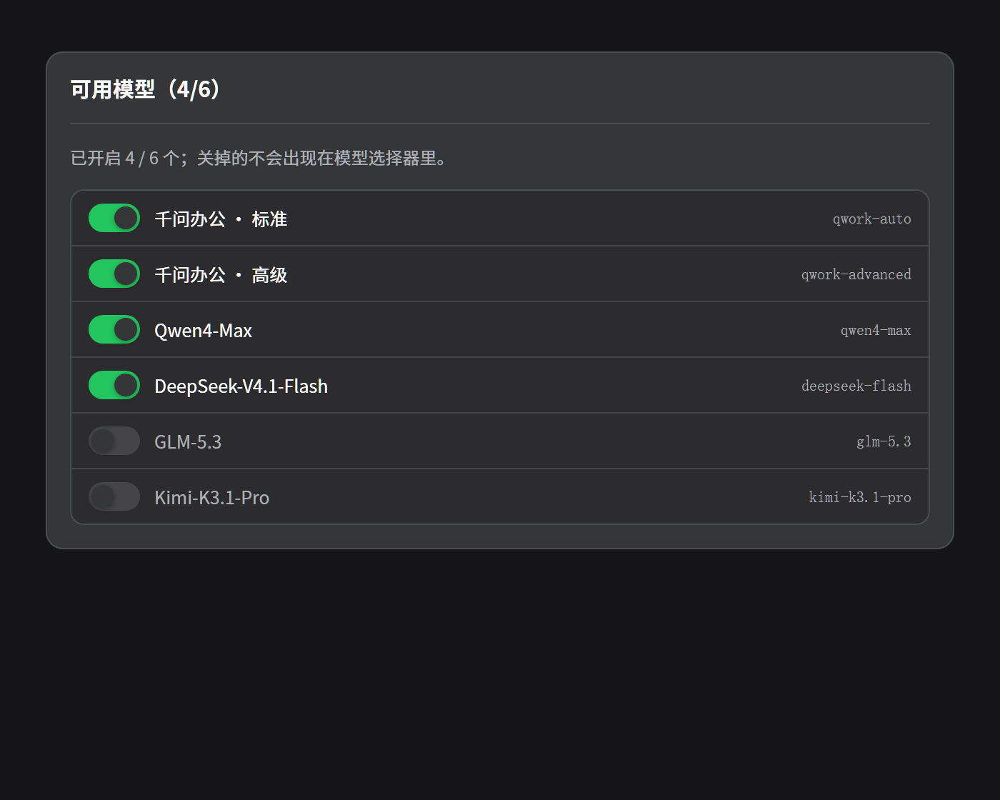

# dsh-connect-qwenwork

[](https://github.com/ponm3ay/dsh-connect-qwenwork/actions/workflows/ci.yml)
[](./LICENSE)

把[千问办公](https://qwenwork.cn/)（QwenWork）接入 [DeepSeek Harness](https://github.com/deepseek-ai/deepseek-harness)：用自己的千问办公账号在浏览器授权，然后在 DSH 的模型选择器里直接选模型。

这是 [pi-qwenwork-provider](https://github.com/ErkundenSie/pi-qwenwork-provider) 的 DSH 移植版。上游插件给 Pi / Pi Web 用，这一版按 DSH 的插件契约重写了接入层：供应商注册、模型发现、设置页、凭据存储都换成了 DSH 的接缝，协议适配、WASM 签名和流式解码沿用上游（MIT，见 `THIRD_PARTY_NOTICES.md`）。

## 特点

- **浏览器授权，无需 API Key。** 打开授权页 → 完成授权 → 插件自动轮询拿到 token，不用粘贴验证码。
- **进程内回环反代，无常驻进程。** 本机 `127.0.0.1` 上起一个只认 OpenAI chat completions 的小服务，把 DSH 的请求改写成千问办公要的签名请求。不需要 magpie、不需要单独守护进程、不需要记端口。和 dsh-connect-autoclaw / workbuddy / qoder 用的是同一个模式。
- **随附官方签名组件。** 按 SHA-256 识别千问办公 2.1.0 的官方 WASM 组件并自动使用对应版本，换机器或移动插件目录都不用重配。
- **模型目录跟随账号。** 授权后读一次账号的模型目录，可在设置页手动刷新；读不到时用内置快照，不会把模型选择器清空。
- **逐模型开关与能力。** 每个模型可以单独开关，并单独调上下文窗口、图片输入、思考强度；改过的标「已改」，一键撤回跟随目录。
- **冒烟测试。** 「测连接」只读账号接口验证凭据，零消耗；模型测试逐个发最小请求，读到模型真正输出就断开。
- **凭据不出本机。** 存在 `$DSH_HOME/.qwenwork-auth.json`（0600）。设置页的浏览器那一半永远拿不到 token。

## 安装

**插件市场 / 本地目录：** 在 **插件** 里添加这个包的目录，安装后重启 DSH。

**从 GitHub 安装：**

```sh
git clone https://github.com/ponm3ay/dsh-connect-qwenwork.git
```

然后在 **插件 → 添加插件** 里选这个目录。

包自带 `cordis.patch.yml`，只 insert 一行插件，不改 profile 的默认模型。

## 使用

1. **设置 → 千问办公** → **登录**，在浏览器完成授权。
2. 新会话的模型选择器里选一个千问办公模型。
3. 在设置页逐模型调：开关、上下文窗口、图片输入、思考强度。改过的标「已改」，点「跟随目录」撤回。



详细说明（模型表、思考开关、输出预算、测试按钮、环境变量、排查）见 [docs/DETAIL.md](docs/DETAIL.md)。

## 开发

```sh
npm run check     # 清单校验 + 单元测试 + 浏览器半契约
```

单元测试用桩替换上游传输和签名器，不联网、不扣积分；真实 WASM 组件会被加载并验签，用来确认随附组件本身可用。

需要对着真实 DSH 运行时验证的四个脚本（`smoke` / `capabilities` / `mount` / 运行时抽取）见 [CONTRIBUTING.md](./CONTRIBUTING.md)。

## 结构

宿主半按职责分层，能力判断只有一个来源（`model-resolve.mjs`），界面和安全各自独立：

| 层 | 文件 | 作用 |
| --- | --- | --- |
| 协议 | `constants` `account` `catalog` `chat` `wasm` `runtime` `errors` | 千问办公的线上事实（MIT，移植自上游） |
| 状态 | `store` `catalog-store` `model-state` | 凭据、目录缓存、逐模型覆盖，各自落盘 |
| 解析 | `model-resolve` | 目录事实 + 用户覆盖 → DSH 看到的模型 |
| 传输 | `shim` `adapter` | 回环服务 + pi-ai 描述 |
| 界面 | `panel` `panel-view` `http-fence` `http-json` `client.js` | 设置页路由、载荷形状、安全围栏、浏览器半 |
| 入口 | `index` `login` `probe` | 插件入口、授权流程、冒烟测试 |

## 许可证

MIT。协议适配代码来自 [pi-qwenwork-provider](https://github.com/ErkundenSie/pi-qwenwork-provider)，其协议适配又基于 [qwenwork-magpie](https://github.com/tianyn1990/qwenwork-magpie/tree/v0.1.0)。千问办公官方 WASM 组件不在本项目许可范围内。

[](https://github.com/deepseek-ai/deepseek-harness)
